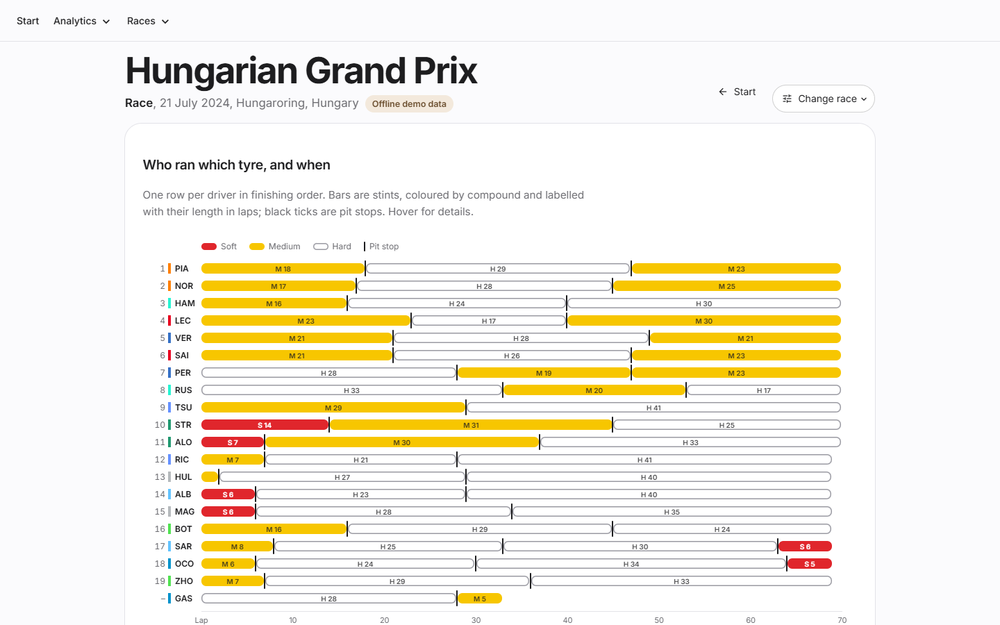
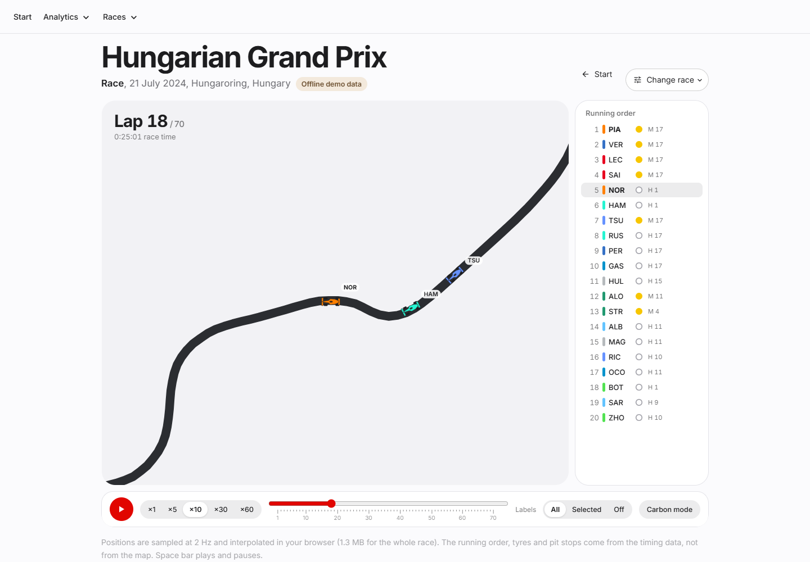
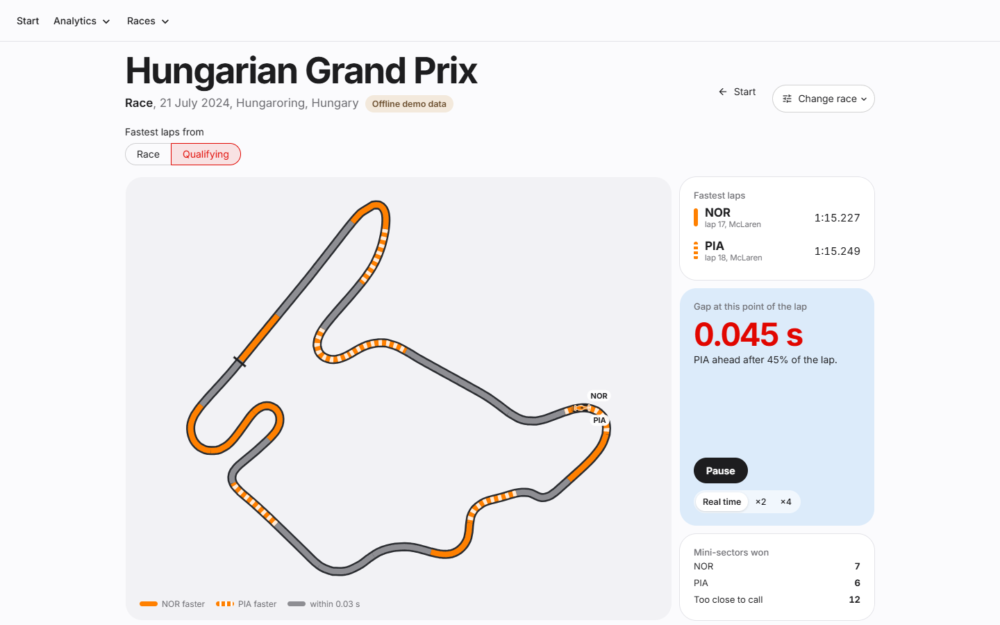

# F1 Race Insights

**Live app: <https://f1-race-insights-nd.streamlit.app/>**

A Formula 1 analytics site built with Streamlit, pandas and Plotly. It has two halves:
**Analytics** (pace, tyre strategy and head-to-head statistics, with the method behind
every number) and **Races** (an animated race replay and a ghost lap on the track map).
It covers the 2023 to 2026 seasons and needs no account or API key. The 2024 Hungarian
Grand Prix is bundled as offline demo data, so the default view always works.

Unofficial project. Data from [OpenF1](https://openf1.org). Not affiliated with Formula 1.


| Overview | Strategy |
| --- | --- |
|  |  |

| Race replay | Ghost lap |
| --- | --- |
|  |  |

## Features

**Analytics**

- **Overview**: the session in five numbers, a lap-by-lap position chart you can play
  back, and a short race story written by fixed templates from computed numbers.
- **Pace**: lap time distribution per driver on clean laps, with the excluded laps and
  the reason each one was excluded.
- **Strategy**: tyre stints of every driver in finishing order, and tyre degradation per
  stint (linear regression with a 95% confidence interval, optional fuel correction).
- **Head-to-head**: two drivers compared lap by lap with a bootstrap confidence interval
  (race), or on their best lap sector by sector (qualifying).
- **Methodology**: every statistic explained, with its assumptions and limits.

**Races**

- **Race replay**: all cars on the track map with a live running order, tyre and pit
  status, safety car banner, playback from ×1 to ×60, a lap scrubber, and a camera that
  follows the car you click.
- **Ghost lap**: two drivers' fastest laps driven against each other in real time, the
  track coloured by who was faster in each of 25 mini-sectors, plus speed and gap traces.

The selection (season, Grand Prix, session, drivers) lives in the URL, so any view can
be shared as a link.

## Architecture

```
app.py                  entry point: page config and navigation
views/                  one file per page (Streamlit code only)
ui/                     app layer
  loaders.py            st.cache_data wrappers (the only in-memory cache)
  state.py              selection in session state + URL query params
  components.py         bento tiles, page header, HTML component helper
  charts.py             Plotly figure builders
  templates/            self-contained HTML/CSS/JS components (canvas, no build step)
f1insights/             pure Python package, no Streamlit imports
  openf1.py             HTTP client: retry, rate limiting, JSON disk cache
  data.py               loaders = fetch + pure pandas transform
  analysis.py           clean-lap filter, statistics, regression, bootstrap
  telemetry.py          resampling, track outline, replay and ghost-lap payloads
  theme.py              colour tokens, Plotly template, global CSS
scripts/build_demo_data.py   builds data/demo and the test fixtures
tests/                  pytest, no network access
docs/data_notes.md      findings of the OpenF1 data spike
```

Python shapes all data; JavaScript only draws and interpolates. Everything in
`f1insights/` is a typed, pure function of DataFrames, which is what makes it testable
without a network or a running app.

## Data pipeline

```
OpenF1 REST API
   │  f1insights/openf1.py   (3 requests/s limit, retry with backoff)
   ▼
JSON disk cache              cache/openf1/      raw responses; finished sessions never expire
   │  f1insights/data.py     *_from_raw transforms: dtypes, joins, null handling
   ▼
tidy pandas DataFrames ────► parquet demo data  data/demo/   (2024 Hungarian GP, 1.9 MB, in git)
   │  analysis.py, telemetry.py                 cache/derived/ (2 Hz replay tables)
   ▼
st.cache_data                ui/loaders.py      keeps results across reruns
   ▼
Streamlit pages, Plotly charts, canvas components
```

A requested session that exists in `data/demo/` is read from parquet and never touches
the network. Car positions are the heavy part (about 35 000 rows per driver per race):
they are fetched per driver, resampled to a shared 2 Hz grid at once, and only the
downsampled table is kept. A full race replay reaches the browser as 1.3 MB.

## Statistics used, and why

| Statistic | Where | Why |
| --- | --- | --- |
| Clean-lap filter | everywhere | Pit laps, lap 1, safety car laps and laps slower than 107% of a driver's median say nothing about pace. Excluded laps are kept with a reason. |
| Median and IQR | Pace | Lap times have a long slow tail; median and IQR barely move when one lap is ruined, mean and standard deviation do. |
| Linear regression, 95% CI, R² | Strategy | Slope of lap time against tyre age is degradation in seconds per lap; the interval shows whether it is distinguishable from zero. |
| Fuel correction | Strategy | Fuel burn makes the car faster each lap and hides tyre wear; an explicit constant (0.035 s per lap) is added back, off by default. |
| Bootstrap CI of the median | Head-to-head | Shows how certain a median gap is without assuming normally distributed differences; fixed seed for reproducibility. |
| Distance-based alignment | Ghost lap | Two laps are compared at the same place on track, not at the same moment; time is rebuilt from distance and measured speed. |

The Methodology page in the app has the full explanation and the limits of each method.

## Limitations

- OpenF1 is unofficial and can be unavailable; then only the demo weekend works.
- Position timestamps jitter by about 0.1 s. Gaps inside a ghost lap are good to
  roughly 0.05 to 0.1 s; the final gap always equals the official lap-time gap.
- Degradation is modelled as a straight line, and one fuel constant is used for all cars.
- The first replay of a race that is not cached takes about half a minute to fetch.
- Gaps between cars are not shown in the replay; the running order comes from timing data.

## Run locally

Python 3.12 or newer.

```
python -m venv .venv
.venv\Scripts\activate            # Windows; on macOS/Linux: source .venv/bin/activate
pip install -r requirements.txt
streamlit run app.py
```

## Rebuild the demo data

```
python scripts/build_demo_data.py
```

This fetches the 2024 Hungarian Grand Prix (race and qualifying) from OpenF1, writes the
parquet files and `index.json` to `data/demo/`, and refreshes the raw JSON fixtures in
`tests/fixtures/`. It takes a few minutes because of the API rate limit.

## Tests

```
pip install -r requirements-dev.txt
pytest
```

The tests cover the transforms, the HTTP client, the analysis functions and the
telemetry payloads. A fixture blocks all network access, and GitHub Actions runs the
suite on every push with Python 3.13.
