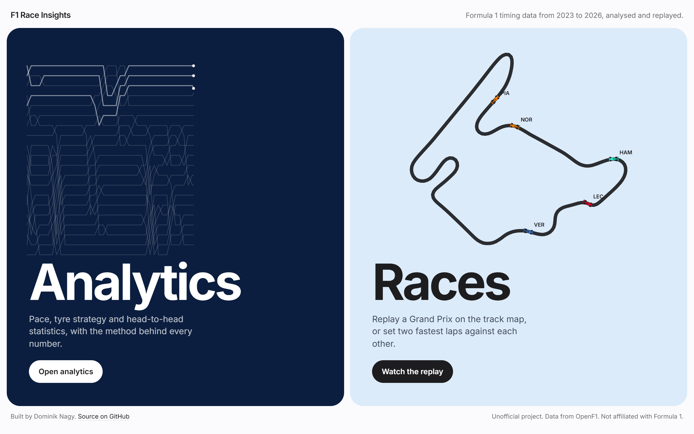
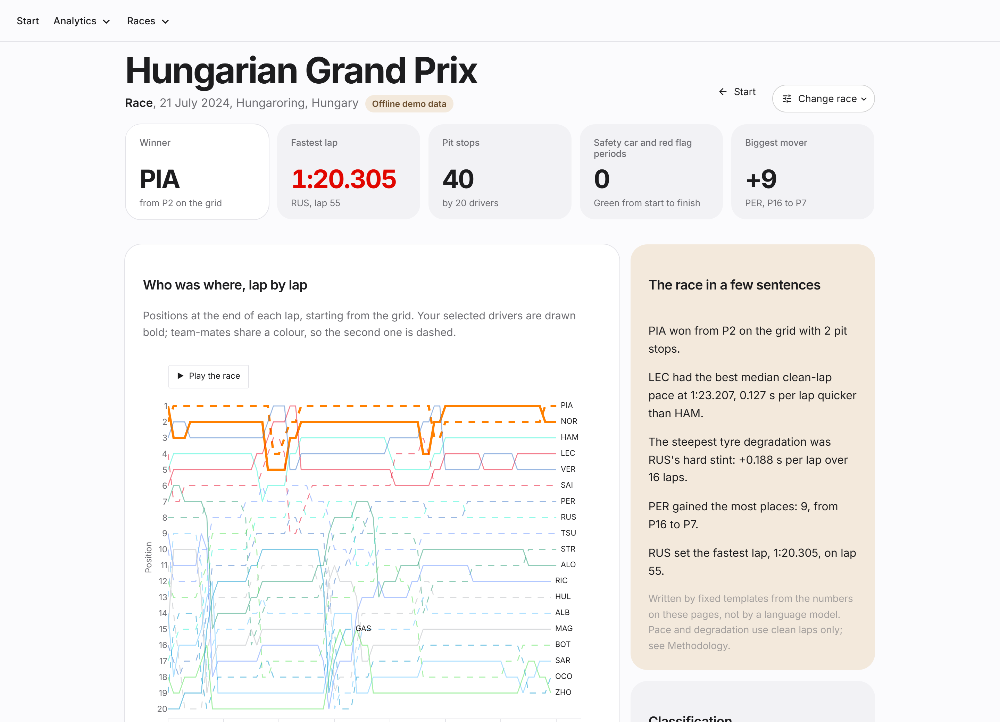
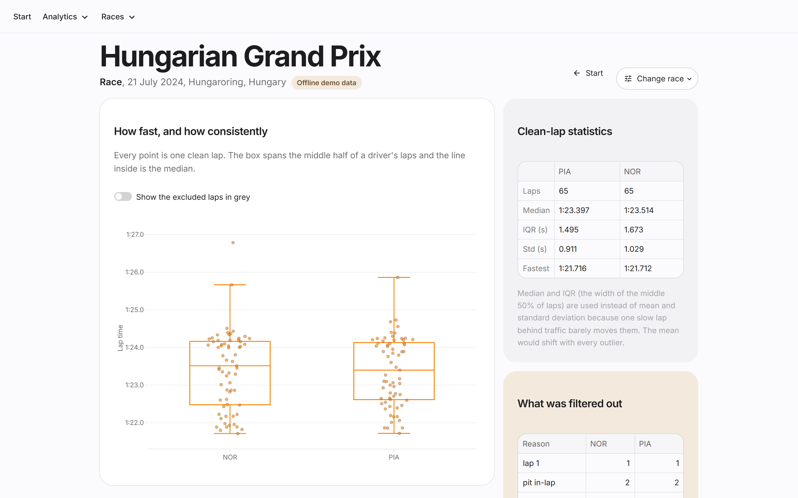
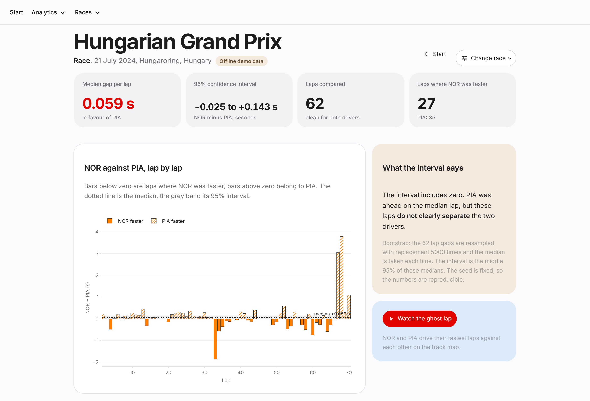
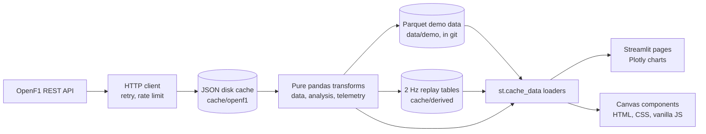

# F1 Race Insights

Formula 1 timing data, analysed with documented statistics and replayed on the track map: a Streamlit app that needs no account and works offline for its demo weekend.

[](https://github.com/NagyDominik1/f1-race-insights/actions/workflows/tests.yml)
[](https://www.python.org/downloads/)
[](https://f1-race-insights-nd.streamlit.app/)
[](LICENSE)



## Live demo

**<https://f1-race-insights-nd.streamlit.app/>**

The default view is the 2024 Hungarian Grand Prix, served from data bundled with the app.
Any other race from 2023 to 2026 is fetched from OpenF1 on demand. The selection (season,
Grand Prix, session, drivers) is stored in the URL, so every view can be shared as a link.

## Feature tour

### Analytics

**Overview.** The session in five numbers, a lap-by-lap position chart that can be played
back, and a short race story written by fixed templates from computed numbers.



**Pace.** Lap time distribution per driver on clean laps only. The excluded laps can be
shown in grey, each with the reason it was excluded.



**Strategy.** Tyre stints of every driver in finishing order, and tyre degradation per
stint as a linear regression with a 95% confidence interval and an optional fuel correction.


**Head-to-head.** Two drivers compared lap by lap with a bootstrap confidence interval
(race), or on their best lap sector by sector (qualifying).



**Methodology.** Every statistic explained in plain language, with its assumptions and limits.

### Races

**Race replay.** All cars on the track map with a live running order, tyre and pit status,
a safety car banner, playback from ×1 to ×60, a lap scrubber and a camera that follows the
car you click.


**Ghost lap.** Two drivers' fastest laps driven against each other, the track coloured by
who was faster in each of 25 mini-sectors, with a live gap in seconds and metres and speed
and gap traces underneath.


### In motion

<!-- GIF placeholders: record these and remove the comment markers.


-->

Recordings of the landing page, the race replay and the ghost lap will be added here
(`docs/gifs/landing.gif`, `docs/gifs/replay.gif`, `docs/gifs/ghost_lap.gif`).

## Architecture



Python shapes all data; JavaScript only draws and interpolates. Everything in `f1insights/`
is a typed, pure function of DataFrames with no Streamlit import, which is what makes it
testable without a network or a running app. A session that exists in `data/demo/` is read
from parquet and never touches the network.

## Data engineering notes

The findings of the data spike are written up in [docs/data_notes.md](docs/data_notes.md).
The ones that shaped the code:

- **Rate limit.** OpenF1 allows 3 requests per second and answers a burst with HTTP 429.
  The client spaces requests 0.4 s apart, honours `Retry-After` and retries 429 and 5xx
  responses with exponential backoff.
- **422 on large queries.** Car positions for a whole session cannot be requested at once
  ("too much data"). Telemetry is fetched per driver, and per lap window with
  `date>=` / `date<=` filters where only one lap is needed.
- **2 Hz resampling.** A race is about 35 000 position rows per driver. Each driver is
  interpolated onto one shared 2 Hz time grid as soon as it arrives and the raw rows are
  dropped. A full race replay reaches the browser as 1.3 MB of base64 `Int16Array` data,
  and the browser interpolates between samples again.
- **Offline fallback.** The 2024 Hungarian Grand Prix (race and qualifying, 1.9 MB of
  parquet) is committed to the repository. If OpenF1 is down the calendar falls back to the
  demo index, and an expired cache entry is served rather than failing.
- **Caching in three layers.** Raw responses as JSON on disk (finished sessions never
  expire, everything else after six hours), derived replay tables as parquet, and
  `st.cache_data` in memory with small `max_entries` for Streamlit Community Cloud.
- **Data quality.** Position timestamps jitter by about 0.1 s, so the ghost lap rebuilds
  elapsed time from distance and measured speed instead of trusting them. Safety car
  periods are not a field and are parsed from race control messages.

## Statistics used, and why

| Statistic | Where | Why |
| --- | --- | --- |
| Clean-lap filter | all pace figures | Lap 1, pit laps, safety car laps and laps slower than 107% of a driver's median say nothing about pace. Excluded laps are kept with a reason. |
| Median and IQR | Pace | Lap times have a long slow tail. One ruined lap barely moves the median and IQR, but shifts the mean and standard deviation. |
| Linear regression, 95% CI, R² | Strategy | The slope of lap time against tyre age is degradation in seconds per lap; the interval shows whether it differs from zero. |
| Fuel correction | Strategy | Fuel burn makes the car faster each lap and hides tyre wear. A stated constant (0.035 s per lap) is added back; off by default. |
| Bootstrap CI of the median | Head-to-head | Shows how certain a median gap is without assuming normally distributed differences. Fixed seed, so results are reproducible. |
| Distance-based alignment | Ghost lap | Two laps are compared at the same place on track, not at the same moment, in 25 equal-distance mini-sectors. |

The Methodology page in the app explains each method and its limits in full.

## Testing and CI

- 57 pytest tests cover the transforms, the HTTP client (cache, retry, range filters), the
  analysis functions and the telemetry payloads.
- Realistic inputs come from small raw OpenF1 responses saved in `tests/fixtures/`; known
  answers come from synthetic data (a regression with a known slope, a bootstrap with a
  known true difference, a lap around a circle).
- A fixture blocks all network access, so the suite runs offline in about two seconds.
- GitHub Actions runs the suite on every push and pull request with Python 3.13.

```
pip install -r requirements-dev.txt
pytest
```

## Project structure

```
app.py                       entry point: page config and navigation
views/                       one file per page
  landing.py  overview.py  pace.py  strategy.py  head_to_head.py
  methodology.py  replay.py  ghost.py
ui/                          app layer (Streamlit)
  loaders.py                 st.cache_data wrappers
  state.py                   selection in session state and URL query params
  components.py              bento tiles, page header, HTML component helper
  charts.py                  Plotly figure builders
  templates/                 self-contained HTML/CSS/JS components, no build step
f1insights/                  pure Python package, no Streamlit imports
  openf1.py                  HTTP client: retry, rate limit, JSON disk cache
  data.py                    loaders = fetch + pure pandas transform
  analysis.py                clean-lap filter, statistics, regression, bootstrap
  telemetry.py               resampling, track outline, replay and ghost-lap payloads
  theme.py                   colour tokens, Plotly template, global CSS
scripts/
  build_demo_data.py         builds data/demo and the test fixtures
  take_screenshots.py        captures the README screenshots with Playwright
data/demo/                   offline demo weekend (parquet + index.json)
tests/                       pytest suite and raw fixtures
docs/                        data notes, screenshots, GIFs
.github/workflows/tests.yml  CI
```

## Run locally

Python 3.12 or newer.

```
git clone https://github.com/NagyDominik1/f1-race-insights.git
cd f1-race-insights
python -m venv .venv
.venv\Scripts\activate            # Windows; on macOS/Linux: source .venv/bin/activate
pip install -r requirements.txt
streamlit run app.py
```

## Rebuild the demo data

```
python scripts/build_demo_data.py
```

Fetches the 2024 Hungarian Grand Prix (race and qualifying) from OpenF1, writes the parquet
files and `index.json` to `data/demo/`, and refreshes the raw JSON fixtures in
`tests/fixtures/`. It takes a few minutes because of the API rate limit.

To refresh the screenshots in this README (uses Playwright's Chromium, or an installed
Edge or Chrome):

```
pip install -r requirements-dev.txt
python scripts/take_screenshots.py
```

## Limitations

- OpenF1 is unofficial and can be unavailable; then only the demo weekend works.
- Data starts in 2023. Sessions that are in progress may be restricted by OpenF1.
- Gaps inside a ghost lap are good to roughly 0.05 to 0.1 s, less in braking zones; the
  final gap always equals the official lap-time gap.
- Tyre degradation is modelled as a straight line, with one fuel constant for all cars.
- The first replay of a race that is not cached takes about half a minute to fetch.
- The replay shows the running order from timing data, not gaps between cars.

## Disclaimer

This is an unofficial project. Data comes from [OpenF1](https://openf1.org). It is not
affiliated with, endorsed by or associated with Formula 1, the FIA or any team. No official
logos, fonts or liveries are used; team colours appear only as data colours.

## Author

Dominik Nagy. Released under the [MIT License](LICENSE).
